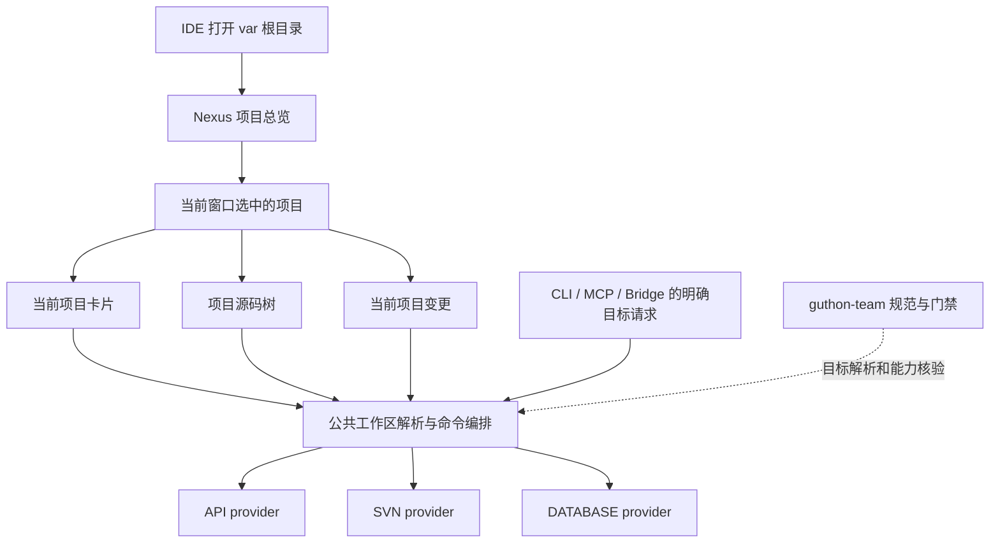

# GuthonCodeTool 长期设计方案：API 优先与多项目统一工作空间

日期：2026-11-19。版本：设计稿 V1.1。

本文整理本轮讨论已经确定的产品方向、工作区模型、Nexus 展示、兼容与迁移边界，并给出后续实施和验收顺序。本文是目标设计，实施进度单独记录，不以设计文字代替安装或平台验收。

实施状态（2026-11-19）：P1 公共契约、P2 三层视图与诊断、P3 旧 provider 执行已在本地工作树接入。验证记录见 [P1](p1-public-contract-validation.md)、[P2](p2-project-views-validation.md)、[P3](p3-provider-integration.md)。P4 已接入离线配置升级及 SVN 源侧预检，见 [P4 阶段记录](p4-configuration-upgrade.md)。API 候选下载、核对和正式切换仍待实现。

## 1. 已确定的方向与范围

| 事项 | 长期决策 |
|---|---|
| 产品定位 | API 是主流和优先发展的源码同步方式；SVN、DATABASE 用于兼容仍在使用的老项目 |
| 工具形态 | 形成同一主干、同一套 Nexus 与工具发行，按项目接入不同源码 provider |
| IDE 入口 | IDE 持续打开开发根目录（默认 `var/`，可自定义），在同一窗口处理其中多个项目 |
| Nexus 布局 | 采用“项目总览＋当前项目卡片＋项目源码”，不采用全部项目源码同时铺开的方案 |
| 项目与同步方式 | 一个项目或产品只有一种当前同步方式；同一项目不登记成 SVN、API 两个并行项目 |
| SVN 升级到 API | 先按原 SVN 流程上传并确认谷神平台内容生效，再 API 拉取、核对和切换 |
| 老项目兼容 | 工具升级保留既有同步方式、源码目录、本地修改和有效配置；不强制搬目录或迁移 API |
| 老项目目录迁移 | 后续提供显式迁移入口，将已登记项目的独占目录归入开发根的 `workspace/<项目目录>/`，保留项目身份、同步方式和内容 |
| 新项目体验 | 默认推荐 API；为接入已有老项目保留 SVN、DATABASE 入口 |
| 界面收敛 | 日常操作集中到卡片；首次配置进入向导和设置；低频脚本与维护操作退出首页 |
| 发布与业务验证 | 源码保存、SVN 提交、API 上传、平台生效及业务验收分别判断 |

本设计同时覆盖 GuthonCodeTool 后端、Nexus、Bridge、MCP 及 guthon-team 的衔接。它不要求三种 provider 拥有相同功能，不新增 DATABASE 自动上传或跨 provider 自动回退能力。

## 2. 术语与身份

| 概念 | 含义 |
|---|---|
| `toolHome` | 显式选定的本地数据目录，承载 `config/`、`var/` 等；不从工具源码位置推断 |
| 工作空间 | IDE 打开的 `var/` 根，包含多个已登记项目及共享规范、文档和工具运行内容 |
| 项目工作区 | 某个项目或产品在本机的配置、源码、索引及文档集合；界面统一称“项目” |
| `workspaceKey` | 项目工作区的稳定技术身份，供 CLI、Nexus、Bridge、MCP 和团队插件路由 |
| 同步方式 / provider | 当前项目使用的 `api`、`svn` 或 `database`，决定源码获取和修改交付方式 |
| 当前项目 | 本 IDE 窗口在 Nexus 中选中的项目，决定卡片、源码树和项目变更视图的展示范围 |
| 平台身份与环境 | 实际平台、系统、数据源、租户及环境等身份，按 provider 契约核验；名称相同不表示环境相同 |

项目名称、目录名称和技术身份分离。新项目可以自由命名；已有 `products.<id>`、`projects.<id>` 不因界面统一或迁移 API 而重新生成。新建中性 key 与已有 key 都必须通过统一身份校验，不能由调用方各自猜测格式。

产品、项目、平台继承关系等业务概念仍然有效，但不再通过名称前缀或目录名称决定源码路由、可写性或卡片布局。

## 3. 当前实现与目标之间的差距

以下为 2026-11-19 的定向源码观察，不是完整验收。`main` 核对基线为 `fac137c`，API 工作树 HEAD 为 `449840a`；两处均有未提交修改，因此 HEAD 不能代表全部本地实现。

| 范围 | 当前可确认事实 | 长期调整 |
|---|---|---|
| 主线工作区 | `main` 的工作区创建与解析支持 DATABASE/SVN，身份使用分类 key | 保留老项目行为，形成同时支持三种 provider 的公共解析结果 |
| API 工作区 | API 工作树使用统一注册表，创建入口及注册结果固定为 API | 去掉公共工作区层的 API 唯一模式假设，保留 API provider 自身实现 |
| API 配置 | `guthon.json` schema 2；现有初始化会拒绝旧分类配置 | 兼容加载旧配置，并设计显式的统一配置升级；普通升级不自动转换 |
| Nexus 项目选择 | API 工作树已有按 toolHome 保存的窗口项目选择，卡片和源码树随选中项目变化 | 增加全部项目常驻总览，将选择和卡片外壳推广到三种模式 |
| 源码与编辑状态 | API 工作树登记多个 checkout，源码树和对应 SCM 聚焦选中项目 | 保留全部登记来源的编辑归属和必要监听，按 provider 管理变更 |
| 旧 Nexus 入口 | `main` 仍有较多树形配置项、同步项和维护命令 | 重新归位到卡片、项目设置、接入向导及维护菜单 |
| 团队治理 | 现行团队规范分别描述 API、SVN、DATABASE，并区分源码写入门禁 | 让公共目标解析适配统一模型，继续保留 provider 的写入与验证边界 |

本轮直接参考的实现入口：

- [工作区身份](../../scripts/common/workspace_identity.py)、[注册与解析](../../scripts/common/workspace_registry.py)、[创建入口](../../scripts/common/workspace_config.py)、[配置存储](../../scripts/common/config_store.py)。
- [Nexus 窗口选择](../../plugins/GuthonNexus/gushen-vscode-completion/src/tool-workspace.js)、[接线入口](../../plugins/GuthonNexus/gushen-vscode-completion/src/extension.js)、[API 项目卡片](../../plugins/GuthonNexus/gushen-vscode-completion/src/api/project-card.js)。
- [API 源码树与变更视图](../../plugins/GuthonNexus/gushen-vscode-completion/src/api/source-ui.js)、[API 编辑与监听接线](../../plugins/GuthonNexus/gushen-vscode-completion/src/api/activate.js)、[工作空间初始化](../../scripts/common/workspace_layout.py)。

同路径文件在 `main` 与 API 工作树可能具有不同实现；这里的链接指向本文所在工作树。已有[目录与团队插件方案](workspace-layout-and-guthon-team-plan.md)、[官方能力吸收记录](official-adoption.md)和[客户端验收记录](client-acceptance.md)描述各自阶段的设计或证据，不代表本长期方案已完成。

## 4. 总体架构与职责



### 4.1 共享底座

共享部分承担稳定身份、路径解析、能力摘要、命令路由、运行入口、更新、日志和操作结果的公共投影。Nexus 项目选择与卡片外壳只依赖这些公共结果，不直接读取某种配置文件或自行拼接源码路径。

继续优先使用 `gusen_hub.py` 等现有共享入口；配置读写归配置模块，provider 差异归对应 provider。CLI、Bridge、MCP 与 Nexus 不分别实现一套项目解析。

### 4.2 Provider 保留的职责

| Provider | 自身负责的流程 |
|---|---|
| API | 登录会话、平台对象与资源读取、本地快照和基线、受控编辑、拉取与上传、冲突及操作回读 |
| SVN | 授权范围、原生 working copy、BASE 与物理 diff、更新和合并、按 working copy 分组的提交 |
| DATABASE | 上游镜像导出、readonly/workcopy 分离、数据库及源码资料、既有工作副本交付方式 |

公共层统一“查看状态、获取源码、查看变更”等用户目标，执行时继续使用 provider 已有的真实语义。API 上传不会转换为 SVN commit；DATABASE 导出不会被包装成具备平台上传能力。

实现以现有模块中的明确分派为起点，不建立运行时动态加载 provider 的插件框架，也不要求三种写入模型服从一个庞大的统一接口。

### 4.3 独立的数据库排查能力

“DATABASE 源码同步”与“数据库排查”是两种不同能力。项目使用 API 或 SVN，不自动获得数据库访问，也不因此丧失经过单独授权和核验的数据库测试能力。源码 provider、数据库测试目标及其权限分别解析，缺少源码能力时不偷偷查询数据库补齐。

## 5. 统一工作区与配置契约

### 5.1 公共解析结果

下表定义目标模型的语义，不是当前 CLI 已支持的完整 JSON Schema；实施时优先复用现有字段，对必要扩展进行版本化。

| 信息 | 要求 |
|---|---|
| 稳定身份 | `workspaceKey`、名称、别名；名称重复时展示候选，不能默认取第一个 |
| 同步方式 | 恰好一个 `sourceMode`，取值为 `api`、`svn`、`database` |
| 项目路径 | 项目根、文档目录、索引和恢复数据目录、运行目录 |
| 源码路径 | 一个或多个明确登记的源码来源；API checkout、SVN 多 working copy、DATABASE readonly/workcopy 各自保留语义 |
| 能力 | 当前 provider 与目标环境实际支持的读取、编辑、同步、交付、诊断等能力 |
| 配置来源 | 当前权威配置格式及来源，供设置入口写回正确位置 |
| 写入绑定 | 当前 provider、源码路径、平台身份及影响写入的配置摘要，用于识别同一 key 下已失效的编辑或操作绑定 |
| 状态 | 本地状态及其检查时间、覆盖是否完整；未知或过期不能当作无修改 |

旧 SVN 的逻辑项目根与物理 checkout 可能分离，不能把所有来源都限制成 `<项目根>/checkout`。跨项目路径重叠和同一源码被重复登记必须在公共解析边界检查。

### 5.2 新旧配置如何共存于工具能力中

采用“公共模型＋格式适配”，而不是让 API 注册器直接读取旧 YAML 后猜测模式。

1. 没有转换的老工作空间，继续以原配置及有效 `source-mode` 契约为权威。启动和只读加载不回写文件；用户实际修改项目设置时，使用原格式已有的写入契约。
2. 新工作空间使用统一配置。统一配置须能登记 API、SVN、DATABASE，provider 参数保留各自结构；新建项目默认推荐 API。
3. 同一个 toolHome 只保留一种生效的配置体系。统一配置与旧配置意外并存时明确报告冲突；显式升级的原文件保存在独立备份位置，不继续参与默认解析。升级中断按第 5.4 节恢复，不把暂存配置与旧配置混读。
4. 老工作空间首次需要在同一空间新增 API 项目时，提供“统一配置升级”预览：按下表转换全部有效配置，保留原 key、路径、同步方式、范围及本地状态。用户执行后统一配置成为唯一权威；这一步不把老项目改成 API。
5. 项目根中的模式描述、runtime descriptor 和能力摘要是权威配置的受控投影。旧格式适配先按原规则解析；与其有效投影矛盾时提示检查，不通过逐字段回退拼成一个貌似有效的项目。

已有 key 的保留需要同时调整 API 工作树目前的身份词法校验和下游调用方；不能只在 UI 中换一个展示名称。多 provider、旧布局和 DATABASE 字段映射的统一配置按新契约版本发布，不向旧 API schema 2 原位加入它不理解的模式语义。新版保留现有 API schema 2 的适配和显式升级入口；新版本编号在 Schema 核定时确定，不支持新契约的旧程序退出该空间的写入流程。

统一配置升级至少逐项处理以下来源。保存位置表达目标职责，正式字段名随 Schema 核定；DATABASE 适配层继续向现有导出流程提供原有结构。

| 现有来源 | 升级后的归属 | 必须保留与核对的内容 |
|---|---|---|
| `products.yaml`、`projects.yaml` | 统一项目登记与对应 provider 参数 | 原 key、业务身份、名称/别名、显式路径、同步方式、系统/数据源映射、include/exclude 及其他有效范围条件 |
| 项目 `context/source-mode.json` 及旧配置中的有效模式字段 | 旧格式适配时按原优先级解析；升级后由权威登记生成模式描述 | 不因缺少旧配置字段而把有效 SVN 项目变成 DATABASE；模式冲突明确报告 |
| `sync.yaml` | 统一同步与共享工具设置 | SVN 共享登录引用、同步与覆盖规则、签出人条件、Git 自动暂存开关、API 参考版本及资源路径等有效设置 |
| `datasource.yaml` | 统一数据源配置 | 连接身份、字段、凭据引用及原选择关系；不展开秘密后写回 |
| `source-tables.yaml` | 统一配置中的独立源码字段映射区 | PAGE、过程函数、系统脚本等实际表名、字段名、关联及继承映射；不能用公开示例或内置默认值替代 |
| `database-testing.yaml`（若已配置） | 数据库测试配置区 | 测试目标、连接/身份引用、默认目标、授权范围及凭据来源 |
| 已有 API 统一配置 | 同版本直接读取，需升级时进入对应版本转换 | 项目登记、API 参数和其他有效分区；不重复导入为第二个项目 |
| 配置引用的脚本、范围清单、文件与环境变量 | 保留有效引用；发生路径变化时显式改写并验证 | 引用基准目录、环境变量表达式、授权范围及文件归属；不执行导入脚本，不复制凭据 |

索引、基线、回执和工作副本属于项目数据，不随配置转换而重建、迁入 JSON 或删除。升级前后比较解析结果：身份、provider、绝对路径、范围、字段映射、连接与测试目标选择均应等价。缺少必需字段映射、无法解释的有效配置或不能保持的引用必须列为阻断项，不静默丢弃。注释和未采用的原始内容随原配置备份保留，不因此生成第二套生效配置。

### 5.3 工具升级、配置升级与项目迁移

| 操作 | 改变什么 | 保留什么 |
|---|---|---|
| 工具升级 | 工具和插件程序 | 项目 provider、目录、有效配置、本地修改和恢复资料 |
| 配置格式升级 | 登记与连接配置的保存格式 | 项目 key、provider、源码路径和交付流程 |
| 项目目录迁移 | 本地项目目录及其配置引用，归入 `<开发根>/workspace/<项目目录>/` | 项目 key、provider、同步范围、本地修改、历史及交付流程 |
| SVN/DATABASE 迁移到 API | 项目的源码同步与交付方式，以及经过核对的 API 基线 | 同一项目身份、文档和历史证据 |

工具更新和 IDE 重载只加载当前登记。配置升级、目录迁移及同步方式切换均由用户分别确认。

### 5.4 配置升级的生效点、版本与中断恢复

统一配置升级采用一次明确的权威配置发布，复用现有配置锁、备份和原子文件替换，不建设通用事务框架。

1. **准备与验证**：识别全部有效来源，备份原文并记录摘要；在准备位置生成新配置，核验 Schema、引用及解析结果等价。此时原配置仍生效，不更新模式描述或 runtime descriptor。
2. **发布前检查**：重新核对来源摘要和当前入口版本，暂停或关闭仍按旧格式写入的 ToolHost、Bridge、MCP 及相关窗口中的配置/源码写操作。来源有变化就重新准备；旧后端无法配合时先停用，不能假定它会识别新版本标记。
3. **发布**：记录原配置备份与目标摘要，将旧 YAML 配置从默认读取位置归档，再原子替换正式统一配置；已有统一 JSON 升版时先备份，直接原子替换，不先移走正式 JSON。正式统一配置完成发布是唯一生效点。旧 YAML 归档到发布之间的短暂间隔属于升级维护阶段，不允许普通入口继续写入。
4. **重新接入**：新后端重新解析权威配置，更新或重建模式描述、runtime descriptor 等派生信息，再恢复操作。原文件留在默认读取路径之外，避免不理解新配置的旧后端继续沿用 YAML 写入；旧发行入口不继续用于已升级的 toolHome。

升级记录仅保存阶段、来源/目标摘要和备份位置，供核对实际状态，不额外引入全局状态服务。恢复规则如下：

| 中断位置 | 恢复方式 |
|---|---|
| 归档前 | 原配置继续生效；准备材料不能被当作正式配置 |
| 部分旧文件已归档，正式统一配置尚未发布 | 阻止普通写入，核对记录与摘要后从备份恢复旧配置，再恢复原流程或重新执行升级 |
| 正式统一配置已发布，派生信息尚未完成 | 以已发布的新配置为准修复派生信息，不因旧描述仍在而退回 YAML |
| 文件与记录无法对应 | 保留现场并报告具体不一致，不按文件存在顺序猜测权威来源 |

新入口遇到不支持的配置版本必须拒绝写入并说明所需兼容版本；旧入口通过停用、归档旧默认配置和重新选择运行入口退出当前空间。发布前核验相关客户端、后端和团队插件所需契约；不能承诺未升级的旧程序会自行理解这些限制。

## 6. 本地目录与根规则

新 API 工作空间沿用已讨论的布局：

```text
<toolHome>/
├── config/                       实际配置与连接引用
└── var/                          IDE 打开的工作空间根
    ├── AGENTS.md                 根规则入口
    ├── rules/                    新空间的团队规范
    ├── docs/                     共用参考资料
    ├── workspace/
    │   ├── 项目甲/
    │   │   ├── checkout/         API 本地源码
    │   │   ├── context/          索引、基线、冲突与回执
    │   │   ├── runtime/          日志和缓存
    │   │   └── docs/             本项目文档，初始为空
    │   └── 项目乙/               按已选同步方式解析源码
    ├── nexus/                    共享运行描述及工具生成参考
    ├── tools/                    工作空间工具入口
    └── .guthon/                  治理状态
```

新增项目登记在开发根的 `workspace/` 下。已有项目在用户执行目录迁移前继续按原登记解析路径。Nexus 的项目总览和源码树读取公共工作区模型。

新 API 空间沿用 `var/` 单一 Git 根，不在项目中自动创建嵌套 Git。已有空间保持现有 Git 状态；团队规范与 Linter 的基础能力不以新建 Git 为前提。不同宿主的根规则加载仍需分别核验，不能仅凭文件存在推断已生效。

规范目录继续遵守现行规则：已有 `rules/` 时使用它；否则沿用 `docs/`；两者都没有时由治理安装流程使用 `docs/`；路径被非目录占用时明确报错。旧空间不会为一次规范更新自动新建 `rules/`。工具生成的 API 参考与团队受管规范保持不同归属。

`context/` 中索引可以重建，基线、冲突和操作回执属于恢复材料；被 Git 忽略不表示可以随意删除。旧 SVN 历史、工作副本状态与 DATABASE Workcopy 基线也不并入 API 索引。目录或规则调整保留人工内容和既有更近目录规则。

### 6.1 已登记项目的目录迁移（后续开发）

用户可从 Nexus 项目右键选择“迁移目录”，先预览旧路径、目标路径、需更新的引用及阻断项。Nexus 与 CLI 共用后端预检、执行和恢复逻辑。旧分类 YAML 项目先独立完成第 5.4 节的配置升级，再预览目录迁移。普通工具升级、初始化和刷新继续按原登记读取。

迁移以一个登记项目为单位。完成后，同一 `workspaceKey` 的活动项目根及项目独占目录都位于 `<开发根>/workspace/<项目目录>/`。迁移清单从公共模型取得实际源路径，包括历史版本的平铺目录、显式路径和分离的 SVN checkout。已符合目标布局的项目直接报告完成状态。

| 同步方式 | 目标及保留内容 |
|---|---|
| API | 使用项目下的 `checkout/`、`context/`、`runtime/` 和 `docs/`。保留本地源码、基线、冲突材料和操作回执。 |
| SVN | 将项目独占 working copy 归入项目的 `checkout/`，保留 working copy 分组、`.svn` 元数据、本地修改和提交记录。实施时同步调整 SVN 登记与路径校验，使迁移项目和同模式新项目采用相同布局。checkout 与索引、日志和文档仍各自独立。 |
| DATABASE | 保留 `source/readonly/`、`source/workcopy/`、`database/` 及项目索引、运行记录和文档的原有相对结构。保留 Workcopy 内容与 readonly 比对基线。 |

开发根、根 Git、团队规则、共用文档、工具运行目录和上级配置目录继续沿用各自位置。已归档的旧 provider 材料仍作为历史或恢复资料，目录迁移只改本地存放位置和相应引用。目标冲突、共享或归属不明的工作副本、无法更新的受管引用应在预览中明确列出，并阻断受影响项目的迁移。人工脚本和文档中的自定义绝对路径只列出可识别的引用供核对。

1. **预览**。列出源路径、目标路径、保留的未提交修改、需转换的配置与范围清单引用，以及可重建的派生索引。复用现有配置锁和备份机制。
2. **搬移**。用户确认后，暂停相关窗口、ToolHost、Bridge、MCP 和其他受控写入。未保存草稿、进行中的写入及未知结果先处理。记录实际搬移步骤，核对新位置的源码、未提交修改、基线、工作副本身份和历史资料，再更新受管引用并发布同一个项目的登记。跨卷时先复制并核验内容，再让旧位置退出现用布局。迁移过程保留根 Git 的提交历史，不自动暂存或提交路径变化。
3. **回读与恢复**。按新路径回读项目，并验证 Nexus 总览、源码树、变更和操作记录，以及 CLI、Bridge 和 MCP 对同一 key 的解析。配置发布前中断时，依据实际搬移记录恢复原路径或续办；发布后以新登记核对路径并修复派生信息。只有路径与引用核对完成后才标记成功，相关写入入口随后恢复。明确报告备份位置，由用户决定何时清理。

目录迁移可在项目维持 API、SVN 或 DATABASE 的情况下执行。项目还计划从 SVN 转 API 时，按第 11 节另行核对、拉取和切换。

## 7. Nexus 信息架构

IDE 资源管理器继续展示 `var/` 物理目录。Nexus 只列已登记项目；`rules/`、共享 `docs/`、运行目录和未登记的普通目录不自动成为项目。

```text
GUTHON NEXUS
├── 项目总览                       [搜索] [添加] [更多]
│   ├── ● 项目甲    API          3 修改
│   ├── ○ 项目乙    SVN          1 修改
│   └── ○ 项目丙    DATABASE     状态待检查
├── 当前项目：项目甲
│   ├── 项目身份、连接与当前状态
│   ├── [更新源码] [上传代码]
│   ├── 同步范围 / 源码数 / 本地变更摘要
│   └── [搜索源码] [本地修改] [操作记录]
│       [同步范围] [项目设置] [环境检查]
└── 项目源码：项目甲
    ├── 页面
    ├── 过程函数
    ├── 表 / 视图
    └── 其他实际支持的源码类别
```

### 7.1 项目总览

每个项目占一行，保留名称、同步方式和最必要的本地状态。当前项目明确选中。项目有冲突、恢复待核验或配置异常时，优先显示该事实；信息不完整时显示“待检查”，不展示虚假的零修改或“就绪”。

单个项目条目、路径或 provider 参数错误时，保留其可识别的项目行和具体诊断，允许查看配置、进入设置修复，禁用依赖有效源码身份的操作；其他有效项目继续可选。两个项目存在路径或身份冲突时，只阻断涉及的项目。不能把错误项目静默过滤掉，也不能在其失效后自动把操作转向下一个项目。

项目列表的公共结果需要同时保留有效项目与配置诊断，Nexus 接收并展示后端的 `configErrors` 或等价信息；当前前端只取 `workspaces` 的行为不能直接作为总览契约。整份配置语法损坏、版本不支持或权威来源不明确时，显示全局配置错误，不根据缓存冒充有效项目列表或继续写入，提供明确的修复/升级入口。

列表以登记顺序稳定展示；通过名称、别名或 key 搜索。项目较多时可折叠总览，仍保留当前项目名称和切换入口。完整 key、路径及状态时间进入详情，不挤进常驻行。总览标题栏使用 IDE 原生图标和级联菜单。三个面板采用同一种 Webview 视图类型，在 CodeBuddy 展开时持续显示适用的原生标题栏操作。“工具设置”与“检查更新”位于总览的“…”中。当前项目标题栏的“更多”提供打开项目目录、查看工作区源码、配置 MCP，以及按 provider 显示的原生“项目设置”和“源码工具”子菜单。

列表只读取登记和已有本地摘要。打开工作空间不会为展示全部项目而逐个登录平台、拉取源码、重建索引或查询数据库。当前项目状态检查及显式刷新才触发相应工作；操作完成后更新所属项目的摘要。

初次打开根目录且没有有效选择时，总览正常展示，卡片提示选择项目，源码区域保持空态；项目排序不隐含默认操作目标。窗口重载可恢复有效选择；项目删除或失效时清除其可操作选择并提示原因。失效但仍登记的项目继续显示诊断行，点击后进入诊断/修复状态，不加载或操作旧缓存中的源码身份。

### 7.2 当前项目卡片

卡片保持统一布局，字段与按钮由 provider 能力和当前状态决定。项目名称和同步方式始终可见，版本、连接地址、账号或导出来源只在有意义且可核实时显示。不会强迫 SVN、DATABASE 提供 API 登录字段。

| 模式 | 获取源码主操作 | 修改交付入口 | 主要状态来源 |
|---|---|---|---|
| API | 更新源码 | 上传代码 | 平台会话、本地快照、基线差异和 API 操作记录 |
| SVN | 更新源码 | 提交 SVN，进入现有变更审阅 | working copy、物理 diff、BASE 与提交记录 |
| DATABASE | 更新源码 | 查看工作副本，沿用现有交付流程 | readonly/workcopy 差异与导出状态 |

无可交付内容、身份未核验、登录失效或存在阻断条件时，按钮说明具体原因。配置错误或暂时离线不应阻止仍然可用的本地源码浏览。

六个常用入口的职责固定：

| 入口 | 用户目标 |
|---|---|
| 搜索源码 | 在当前项目有效索引范围找对象、名称或代码；显示索引覆盖边界 |
| 本地修改 | 查看当前项目变更及差异，进入 provider 对应的变更处理 |
| 操作记录 | 查看当前项目真实的更新、导出、上传或提交记录，保持记录类别和结果含义 |
| 同步范围 | 配置 API 子系统、SVN 授权地址/目录或 DATABASE 已支持的导出范围 |
| 项目设置 | 维护当前项目连接、登录、路径与适用参数；源码模式迁移走独立向导 |
| 环境检查 | 检查本项目所需依赖和连接条件，提供针对性修复入口 |

### 7.3 项目源码

源码树在视图内容区渲染，定位、搜索、刷新和过滤按项目能力出现在原生标题栏。

源码树只展示选中项目，分类使用统一名称和图标，但类别取自实际能力。API 的模块参数、单据类型、下拉组件等不能因为旧模式缺少对应能力而隐藏；旧模式也不生成没有数据支持的占位类别。

源码树保留业务名称、对象身份、只读继承标识和变更装饰；打开方式继续复用对应 provider 的编辑器、虚拟文档和受控写入流程。物理文件、对象条目、页面分块之间的关系由 provider 提供，不靠树节点数量推算文件数量。

搜索、树过滤与折叠只影响展示，不改变同步范围或上传/提交集合。项目文档仍可通过 IDE 资源管理器及项目设置中的目录入口访问，不混入源码对象分类。

## 8. 项目切换、编辑与操作目标

1. 点击项目行只改变本窗口的当前项目，卡片、源码树和项目变更视图一起更新；IDE 打开的根目录保持不变。
2. 已打开标签页、未保存草稿及恢复状态保留。文件保存按文档自身绑定的 key、provider 和源码身份处理，不按卡片当前项目重新解释。
3. 已打开旧项目的文件不自动改变当前项目。需要将 Nexus 定位到该文件时，使用明确的“在所属项目中定位”入口，并一起切换项目和树位置。
4. 更新、上传、提交等操作在发起时绑定项目与范围。切到另一个项目后，原操作继续显示原目标，结果进入原项目记录，不跟随新选择重定向。
5. 切换期间旧项目的迟到响应不能覆盖新卡片或源码树；已经完成的原项目结果仍可更新其项目总览摘要。
6. 所有已登记源码来源都保留必要的文件归属和增量监听。仅为展示总览，不对全部项目做全量扫描。
7. 项目选择保存于窗口状态，并以 toolHome 隔离；不恢复共享 ACTIVE 文件。多个窗口运行时各自保持选择，重载只恢复有效 key。

Nexus 的选择只属于当前窗口。CLI 使用明确 `--workspace` 或经正式解析的路径；Bridge 以请求中的 key 和页面身份核对目标，多候选仅为本次请求选择；MCP 与 AI 会话仍按其明确绑定解析。它们不盲目读取另一个窗口的当前项目。

Nexus 的项目 SCM 只展示当前项目的 provider 变更。IDE 原生 Git 若以 `var/` 为仓库根，仍展示整个 Git 仓库的变化；项目切换不改变 Git 仓库范围，不自动暂存任何既有修改。

窗口切换与同一项目更换 provider 是两种操作。普通 A/B 项目切换按上述规则保留原文件归属；同一 key 的 provider、源码路径或平台身份改变时，原编辑/操作绑定必须失效。写入边界以当前权威配置核对会话原有绑定，不能只验证 key 仍然存在。优先复用现有身份信息、配置摘要和会话校验，不为界面选择增加一套全局状态机制。

模式迁移需要处理其他窗口、CLI、Bridge、MCP 和工具管理的旧编辑租约，具体规则见第 11.3 节；刷新发起迁移的窗口不能代替所有入口的旧绑定停用。

## 9. 日常同步与修改交付

### 9.1 API 优先体验

“更新源码”覆盖当前范围的读取、现有本地修改保护、变更判断及受影响索引更新。正常流程完成后提供可用结果，不要求用户再手动点击重建索引。更新失败时保留已知事实和可恢复状态，按失败环节提供重试入口。

平台实际资源、物理文件和可编辑条目可以不是一一对应。模块参数等聚合资源应按真实接口和存储粒度组织请求，同一文件中的条目不会仅因在树中多行展示就被当作多个独立同步文件。必要的分页、详情读取与重复请求分别判断；进度中的对象数、文件数和请求数不混用。

上传继续先展示选中内容和差异，核对当前基线并执行原有回读。部分成功、失败和结果未知分别展示；结果未知先核对原操作，不自动重放。上传成功和平台运行验收保持不同状态。

### 9.2 SVN 兼容

“更新源码”使用已登记 working copy 和授权范围；有本地修改时复用现有保护、预览和冲突处理，不静默覆盖。增量索引跟随更新结果维护，整库重建保留为维护能力。

“提交 SVN”进入原生变更审阅，按实际 working copy 分组，以物理文件为提交单位。不能伪装成跨 working copy 原子提交，也不能把上传到 SVN 等同于谷神平台最终提交、生效或运行通过。

### 9.3 DATABASE 兼容

“更新源码”编排当前项目已支持的导出流程，维护上游 readonly、数据库资料和索引；本地修改继续进入 Workcopy。保留 `pull_diff_check` 等有效契约，不为界面统一改变覆盖和既有自动暂存语义。

“查看工作副本”提供变更查看与原有交付入口。没有经过实现和验证的直接平台上传能力，就不提供名为“上传代码”的按钮。所有源码写入继续区分上游镜像和本地修改，不能把 readonly 改成可编辑目录。

## 10. 旧入口如何收敛

| 现有入口 | 目标位置 | 调整原则 |
|---|---|---|
| 驾驶舱中的索引、修改、最近提交摘要 | 项目行与卡片摘要 | 展示事实；详细内容进入对应入口 |
| SVN 登录、地址、数据库连接 | 项目设置 | 保留原能力，按模式显示 |
| 导入/粘贴 checkout 配置 | 老项目接入向导；项目设置中可再次进入 | 首次引导不长期占据首页 |
| 检出/更新、数据库源码导出 | 更新源码 | 前端归并入口，执行语义继续由 provider 管理 |
| 源码模式选择 | 新建/接入时选择；已有项目使用迁移向导 | 不提供无检查的即时模式切换 |
| 搜索完整索引、快速定位源码 | 搜索源码和源码树 | 统一日常入口，保留精确对象定位 |
| 查看或管理源码变更 | 本地修改与 SCM | 差异、冲突、提交/上传保持来源语义 |
| 最近 SVN 提交、拉取历史、上传回执 | 操作记录 | 不把三类记录伪装成相同版本历史 |
| 扫描/重建索引、压实、导出索引文档 | 项目维护菜单或命令面板 | 低频操作，保留预览与影响说明 |
| 运行模式、工具入口、组件更新、toolHome | Nexus 全局设置和更多菜单 | 全局工具配置不重复放在每个项目下 |
| 打开项目目录、打开本地数据目录 | 项目设置、全局菜单 | 保留快捷入口，不当作源码操作 |

脚本作为实现或维护入口可以继续存在。只在调用方核对完成后移除确定无用的脚本或命令，不能因首页不显示而直接删除后台能力。日常操作不要求用户辨认内部脚本名称。

## 11. SVN 到 API 的迁移流程

### 11.1 迁移目标

迁移以同一个项目为对象，保留 `workspaceKey`、名称、文档与历史关联。过程中的 API 候选内容属于该项目的迁移准备材料，不是第二个常驻项目，不进入项目总览的独立项目行。

首版迁移向导只负责检查、准备、核对、切换和留证。SVN 提交、谷神平台上传与最终提交继续由用户按现有流程完成，向导展示完成依据和待处理项；不自动代办旧侧交付、编译、数据库结构变更或业务验收。不建设任意 provider 之间的双向迁移或通用自动回滚，也不建设通用跨格式语义比较引擎。

仍使用旧分类配置的空间先独立完成第 5.4 节的统一配置升级，原项目继续保持 SVN，再进入源码迁移。配置格式升级与本项目 provider 切换分别预览、分别生效，不合并成一次覆盖整个工作空间的源码迁移。

标准路径为：

```text
选定原 SVN 项目
  → 检查并处理本地修改
  → 按原流程提交 SVN 和完成谷神平台上传/最终提交
  → 确认目标平台源码生效
  → API 拉取到独立准备位置
  → 自动检查身份、范围及可比字段，人工确认必要差异
  → 展示切换计划
  → 最终复核候选与旧入口停用条件，再执行切换
  → 同一项目改为 API，同步与交付使用 API
```

### 11.2 分步行为与完成依据

| 阶段 | 要完成的事 | 可以进入下一步的依据 |
|---|---|---|
| 迁移预检 | 明确项目、源 working copy、API 目标环境和范围，列出未保存、未提交、冲突及未知操作 | 身份唯一，待处理内容和迁移范围可审阅 |
| 旧侧交付 | 用户按原 SVN 流程上传，包含实际要求的谷神平台最终提交 | SVN 结果和平台生效结果分别明确；仅有 revision 不算完成 |
| API 接入准备 | 创建本项目的内部迁移准备上下文，保存候选 API 连接与范围并核验身份 | 正式登记仍为 SVN；候选读取的是原项目实际生效的目标 |
| 拉取候选 | 复用 API provider 的读取能力，在与旧 checkout、索引及基线分离的位置拉取 | 请求结果完整，缺失或失败条目明确；正式来源和已有基线未改动 |
| 一致性核对 | 检查身份、范围、对象清单及明确可比字段，列出需要人工确认的差异 | 必要对象均已覆盖，自动结果与人工确认分开记录，阻断项已解决 |
| 切换预览 | 列出保留的 key、新 provider、生效路径、配置变更、旧历史位置和待关闭会话 | 用户可审阅具体切换结果 |
| 最终复核 | 复核权威配置、本次范围的旧侧修改/写入状态、候选与平台清单/内容，确认旧写入入口已停用 | 候选仍有效；新修改或变化已处理并重新核对，旧会话不再具备有效写入绑定 |
| 执行切换 | 准备完整 API 源码及基线后，发布同一项目的新登记，再刷新派生信息 | 新登记发布为唯一 provider 切换点；API 状态、卡片、源码树和工具身份一致 |
| 迁移验收 | 检查 API 读取、差异、编辑归属及实际需要的后续操作 | 迁移结果可复核；平台上传和业务验证另按其实际证据记录 |

跨格式核对限定为以下范围，不要求 XML、JSON、GSS 等格式之间达到自动语义等价证明，也不能仅用文件总数判断迁移完成：

| 核对方式 | 首版职责 | 结果含义 |
|---|---|---|
| 自动检查 | 核验平台/项目及系统、数据源身份，按明确映射检查对象 ID、类型、继承归属、范围清单和缺项；核对能按已知契约直接比较的字段或相同内容表示的摘要 | 仅对实际检查的项目给出结果，不把格式转换或全部业务语义标记为通过 |
| 人工确认 | 对无法自动比较的必要内容列出来源、对象、差异及旧侧交付依据，由用户针对具体差异确认 | 单独记录确认范围与依据，未比较内容不改写成自动通过 |
| 阻断项 | 身份不符、必要对象缺失、范围映射不清、关键差异未解决或必需内容无法核对 | 不执行最终切换；人工确认不能掩盖缺失身份、必需覆盖或读取失败 |

对象清单应按实际映射反映新增、删除或改名后的身份，不能仅抽查几个关键对象后宣称全部范围一致。自动比较能力只覆盖已有可靠映射，不为一次迁移新增全平台通用比较器；其余必要差异进入人工确认。API 拉取成功仅表示相应读取完成，平台上传和业务运行结论另行记录。

#### 候选拉取与最终复核

当前普通 API 入口要求正式 `sourceMode=api`。后续迁移实现需要独立的内部准备入口：从有效 SVN 项目和明确迁移请求构造候选上下文，绑定原 key、原配置摘要、候选平台/范围以及独立的 checkout/context 路径，再调用 API provider 的读取实现。准备入口只允许平台读取与候选本地数据写入，不开放 API 上传或常规编辑；不临时改正式模式、不登记第二个项目，也不放宽普通 API 入口的模式检查。

候选保存其范围、对象清单、可用版本/内容摘要与核对依据。用户预览后再次执行时，必须先核对原配置绑定、本次范围内旧侧的未保存/未提交修改及活动写入、候选文件、平台范围清单和相关内容是否变化，不能因之前拉取成功而无限期复用。平台有可靠版本标识时使用该标识，否则按实际接口重读必要清单与内容；变化时重新准备受影响部分，更新差异并再次审阅，缺少核验依据时停止切换。

最终复核不要求全平台锁，也不承诺平台提供跨请求一致快照；它记录实际读取时的事实。迁移后的 API 更新和上传仍使用原有最新基线、冲突检查及回读契约。候选上下文和前后置检查只用于本项目的迁移准备，不扩展成长期并行运行两种 provider 的能力。

### 11.3 目录、历史与恢复

优先保留项目文档和稳定的逻辑根；API checkout、索引和基线按新 provider 的实际需要准备。如果必须使用新目录，切换同一登记项的路径，仍不新增第二个项目身份。现有 API 解析器固定路径的假设需要在统一模型实施时处理。

旧 SVN working copy、历史和交付证据继续保留为历史或恢复来源，停止作为 Nexus 当前项目的同步和编辑入口。它们不会自动删除、移动、改 Git 跟踪状态或被 API 源码覆盖。旧索引不当作 API 索引，旧 revision 不当作 API 版本号。

切换前处理该项目在相关 IDE 窗口中的未保存编辑、活动写操作，以及 ToolHost、CLI、Bridge、MCP 和受控编辑租约中的旧绑定；不只检查向导所在窗口。未完成或结果未知的写操作先查明结果，不能被迁移过程直接丢弃。必要的 SVN 旧侧交付完成后到正式切换之间，不再继续向旧侧交付新修改；如果继续修改，返回准备和核对阶段。

在最终切换前关闭或使工具管理的旧可写会话、租约及排队写请求失效。新后端的写入边界重新解析当前 provider、实际源码路径、平台身份及相关配置摘要，旧绑定不一致时拒绝写入并要求重新接入；不能把相同 key 当作会话可继续使用的依据。其他窗口保留未提交草稿供恢复，不将旧会话悄悄改绑到 API；旧虚拟编辑器重新打开后才可按新来源继续。仍按旧配置运行且不支持核验的后端必须先停用，不能证明旧受控写入入口已停用时不执行切换。

完成候选及最终复核后，先准备可用的 API 源码和独立基线，再以权威配置中该项目的新登记发布作为切换生效点。此后模式描述、卡片、索引入口和会话委派按新登记重建；派生信息未完成时显示待恢复，不继续接受旧 SVN 写入。保留迁移阶段、源/目标绑定、配置摘要、备份位置及自动/人工核对结果，用于中断后核验实际状态；复用第 5.4 节的配置发布与恢复原则，不另外建设跨 provider 事务框架。

切换前失败时，原 SVN 项目继续有效，可处理失败后重新准备。切换结果不明确时先核对当前配置、文件和原操作，再决定恢复或续办。切换后已有 API 修改或上传时，恢复 SVN 属于新的显式切换，不能简单把模式字段改回去，也不能通过重放旧上传制造一致性。

### 11.4 DATABASE 迁移边界

DATABASE 老项目先通过其现有交付方式让目标平台源码生效，再执行 API 目标核验、候选拉取、内容核对和切换。本文不新增“数据库直接上传到 API”的捷径，也不把 Workcopy 直接复制为已确认的平台基线。具体旧侧交付步骤在对应环境实施迁移前核实。

## 12. Bridge、MCP 与团队治理

Bridge 继续使用明确 toolHome、runtime descriptor 和项目身份。DATABASE 的页面拉取、SVN 的页面定位及 API 已支持的操作按能力分别提供；不因统一卡片而让 Bridge 对所有模式执行同一种拉取。

MCP 的公共目标解析与 Nexus 使用同一模型，源码读取、PAGE/过程函数编辑及上传/提交保持 provider 的受控入口和授权条件。服务名或工具名的统一不能提前于实际契约适配；已有配置升级需给出具体差异并保留其他服务。

guthon-team 继续独立管理规范、Linter、Hook 与目标选择。工具提供已核验的 key、provider、路径和能力；团队插件不通过卡片文字、目录前缀或某个窗口选择猜测目标。根规则按 provider 导航到相应源码边界，API/SVN 的受控编辑与 DATABASE 的 readonly/workcopy 区分继续有效。

Nexus 首次初始化开发根时，从用户配置的 guthon-team 的 main 分支调用团队独立安装器。规范、Linter、API 索引和 Git pre-commit 就绪后才创建统一配置并连接该空间。Windows 安装助手在首次内网仓库授权通过后执行同一同步。Agent 生命周期 Hook 可以单独启用。已连接空间可用 setup 重跑同步，旧规范布局继续使用原 docs。工具配置升级和项目源码迁移各有独立入口。普通文档写作无需源码索引、数据库连接或源码写入门禁。

## 13. 实施顺序与主干归并

实施先统一会被多个入口依赖的契约，再接入已确认的 UI；每阶段形成可独立评审和验证的改动。当前 API 开发成果继续使用，不推倒重写，也不长期维护两套不断分叉的完整工具。

| 阶段 | 主要工作 | 阶段完成条件 |
|---|---|---|
| P0：设计基线 | 固化本方案、能力矩阵、现有实现差距 | V1.1 设计边界已固化，后续实现不自动扩大到源码迁移 |
| P1：公共契约 | 统一 key 校验、工作区解析、写入绑定、路径与能力摘要；适配旧配置与现有 API 配置 | 三种项目正确列出，项目诊断完整；旧配置只读载入无改写，目标与路径不串用 |
| P2：Nexus 外壳 | 项目总览、当前卡片、当前源码联动和单项目故障隔离；收敛旧入口 | 根目录不变，窗口切换、重载恢复、草稿与变更归属正确；单项目错误不拖垮其他有效项目 |
| P3：完整 provider 接线 | 连接三种更新流程、变更和记录入口，完成 CLI/Bridge/MCP/团队插件衔接 | 旧能力回归通过，API 优先能力保留，缺失能力如实显示 |
| P4：配置升级与源码迁移 | 完整配置转换与单一发布点；实现候选读取、有限核对、旧绑定失效和显式切换 | 同一项目身份保持，旧侧交付沿用现有流程；候选不过期复用，配置/迁移中断可查且可恢复 |
| P4 后续：存量目录迁移 | 按第 6.1 节接入项目目录预览、离线搬移、配置引用更新与恢复 | 已迁移的 API、SVN、DATABASE 项目均以新目录布局运行，同步方式、未提交修改和历史可回读 |
| P5：交付与验收 | 文档、打包、安装和真实客户端及平台分层验证 | 实际交付范围与验证证据匹配，明确未覆盖环境 |

实施前分别检查主线、API 工作树和 guthon-team 的现存改动，按共享修复、provider 功能、配置变化、UI 与文档分类。公共修复落到共同入口；逐项整合 API 功能，不直接合并两套入口后堆叠分支条件。

SVN/DATABASE 兼容的重点是有效契约和能力，不要求保留旧树的全部按钮位置。配置读写、源码保护和平台交付语义稳定后，才删除被统一入口取代且已核对无调用的冗余代码。主干整合、提交、发布及安装均由后续任务明确授权。

## 14. 验收矩阵

以下是各阶段的完整验收要求。各阶段记录列明本地测试、客户端与平台验收的覆盖范围。

| 场景 | 通过条件 |
|---|---|
| 同根多项目 | API、SVN、DATABASE 各一个项目，在同一根窗口总览中各出现一行 |
| 登记与物理目录 | 只显示已登记项目，共享 rules/docs/runtime 不被识别成项目 |
| 单项目配置错误 | 保留诊断行与设置入口，仅禁用相关源码操作；其他有效项目继续可选，诊断不被注册器丢弃 |
| 项目冲突与全局错误 | 路径/身份冲突只阻断涉及项目；整份配置无法解析或版本不支持时显示全局错误，不用缓存继续写入 |
| 无有效选择 | 总览可用，卡片和源码区域提示选择；不默认执行首个项目操作 |
| 切换与重载 | 卡片、源码树和项目 SCM 一致；有效选择恢复，失效 key 清除 |
| 多窗口 | 运行中的窗口各自选择，不通过共享 ACTIVE 相互修改目标 |
| 草稿与保存 | A 项目未保存文件在切换 B 后仍属于 A，保存不写入 B |
| 操作中的切换 | A 的更新或上传继续作用于 A，迟到结果不覆盖 B 的界面 |
| 所有来源的监听 | 非当前项目的已登记源码变化有正确归属，不触发全空间重建 |
| Git 与 provider SCM | 项目变更不混入其他项目；原生根 Git 范围与暂存状态不被改变 |
| 旧配置加载 | 原 key、provider、路径、范围及有效配置保留；只读加载不回写 |
| 同空间新增 API | 显式配置升级有预览和备份，旧项目 provider 与源码不被转换 |
| 配置转换完整性 | 登记、有效模式、同步规则、数据源、source-tables 字段映射、测试目标及外部引用均有去向；转换前后解析结果等价 |
| 配置版本与旧入口 | 不支持的新格式拒绝写入；旧默认配置已归档，旧后端停用，凭据引用和环境变量未被展开落盘 |
| 配置升级中断 | 归档前沿用旧配置，归档后发布前可核验恢复，发布后按新配置修复派生信息；不出现双权威或无依据的自动回退 |
| 旧项目目录迁移 | 验证旧平铺项目、显式路径和分离的 SVN checkout；同一 key 的活动项目目录全部归入 `workspace/<项目目录>/`，项目模式及本地修改可回读 |
| 目录迁移冲突与中断 | 目标占用、共享目录或未保存草稿时保留现场；配置发布前后中断均按实际搬移记录恢复或续办 |
| 配置冲突 | 两套意外生效来源不能默默混读；升级备份不参与当前解析 |
| API 聚合资源 | 对象条目、物理文件、分页及请求数准确；无条目驱动的重复文件同步 |
| API 上传结果 | 未选内容不上传；部分成功与未知结果明确，未知先核验原操作 |
| SVN 本地修改 | 更新不静默覆盖，提交按实际 working copy 与物理文件审阅 |
| DATABASE 工作副本 | readonly 不可编辑，Workcopy 和同步保护及原自动暂存范围保持 |
| 能力差异 | 旧模式不显示虚假的上传功能，API 特有类别与能力保持可用 |
| 离线与摘要缺口 | 本地可用内容仍能浏览；过期或不完整状态不显示为零风险、零修改 |
| SVN 迁移成功 | 平台已生效后 API 拉取核对；总览仍为同一个项目，key 保持稳定 |
| API 候选准备 | 正式登记保持 SVN，内部准备入口可读取候选；独立路径不覆盖旧资料，普通 API 模式检查保持，候选不能上传或常规编辑 |
| 跨格式核对范围 | 自动检查和人工确认分开记录，必要清单含新增/删除或改名后的映射；没有通用语义等价或全范围抽查通过的虚假结论 |
| 切换前候选失效 | 配置、范围清单、候选或平台内容变化后重新准备并审阅受影响部分，不能复用过期确认 |
| 旧窗口与旧租约 | 多窗口、ToolHost、CLI、Bridge、MCP 的旧写入与未知操作已处理；同 key 的旧绑定被拒绝，草稿不自动改绑 API |
| 迁移向导范围 | 检查、准备、核对、切换及留证可独立验收；不依赖自动 SVN 提交、平台最终提交、编译或通用双向迁移 |
| 迁移阻断 | 未交付修改、平台未生效、身份不符、范围缺项或关键差异阻止最终切换 |
| 迁移中断 | 可查询阶段及真实状态；旧资料保留，不自动重放或删除 |
| 迁移后恢复 | 有 API 新修改或上传时重新核对交付状态，不直接切回旧模式 |
| 外部入口 | CLI、Bridge、MCP 和团队插件使用同一项目身份，各自授权与写入门禁有效 |
| 客户端展示 | 真实 IDE 根窗口中窄侧栏、浅/深主题、长项目名、键盘操作可用 |
| 安装与平台 | 源码回归、包构建、安装后运行、平台生效与业务结果分别留证 |

验证按改动范围从临时目录、夹具和相关模块测试开始。涉及模式路由或写入时，再执行相应 provider、Nexus、Bridge 及工具自检；真实业务空间不作为可写测试夹具。

## 15. 文档与交付安排

本长期方案是后续归并的设计依据，早期目录方案已链接到本文。早期文档中“API 唯一模式、旧配置拒绝、新数据目录重新接入”等内容继续描述当时实现，不能作为本长期目标的兼容边界。后续代码实施时按最终行为改写用户文档，不把尚未实现的设计写成当前能力。

| 文档 | 实施后的同步内容 |
|---|---|
| README、配置说明与示例 | 支持的 provider、新旧配置边界、统一工作空间入口 |
| 全功能说明 | 工作区模型、模式能力、路由、状态、迁移机制与验证限制 |
| 使用手册 | 项目总览、选择项目、卡片操作、接入与迁移的实际步骤及预期结果 |
| QA 的 `qaItems` | 选择丢失、模式能力差异、状态待检查、迁移阻断及旧源码归属等具体问题 |
| Windows 安装页 | 仅在安装、首次连接、运行入口或修复流程发生变化时修改 |
| AI_CODE_INDEX | 仅在模块职责、入口或调用关系实际改变后同步导航 |
| guthon-team 规范与插件文档 | 目标解析、provider 边界和宿主入口的实际变化；不重复工具完整教程 |

P1 已同步配置与能力边界；P2 在既有章节同步项目总览、当前卡片、当前源码和配置诊断，并调整可搜索 QA。Windows 安装步骤未变，不因公共契约接入而新增安装操作。后续阶段按受影响章节继续同步，执行公开文档校验、链接与搜索检查；发布说明按正式模板另行准备。

## 16. 实施前需要核实的具体事实

以下事项不改变已确定的产品方向，但会决定具体配置或迁移实现；核实前不得宣称具备自动化能力：

1. 各 SVN 老项目从 revision 到谷神平台最终提交、生效的实际流程，以及可用于确认生效的证据入口。
2. 各平台版本 API 能覆盖的源码类别、继承来源、范围和对应身份，与原 SVN 对象的可靠映射，以及最终复核实际可用的版本或内容摘要；自动与人工核对按第 11.2 节分工。
3. 按第 5.2 节清单核定完整 Schema，包含 DATABASE 字段映射与引用基准；确认第 5.4 节所需的版本拒绝、旧入口停用与发布恢复步骤。
4. 各旧目录、working copy 和团队插件实际版本对新解析结果的适配；通过隔离配置和最小只读身份核验确认，不全量扫描真实业务源码。
5. 真实客户端中窗口选择恢复、未保存编辑、旧绑定失效、规则加载与 Hook 的实际行为；源码测试或本轮示意均不能替代它们。

后续开发任务按上述阶段推进。配置升级与 SVN→API 切换、核对和恢复的本地证据见 [P4 实施与验证记录](p4-configuration-upgrade.md)。真实平台及业务验收按具体环境另行执行。
